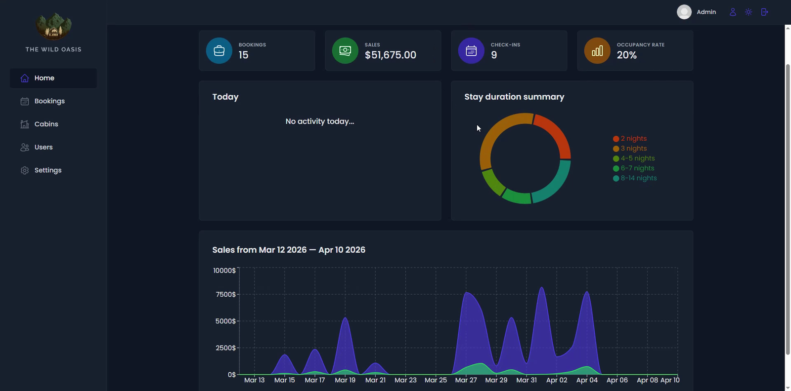
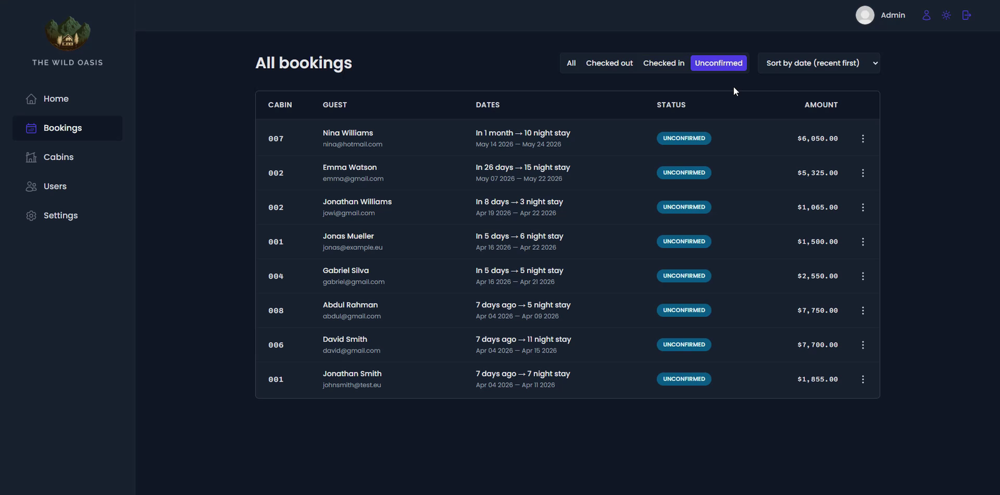
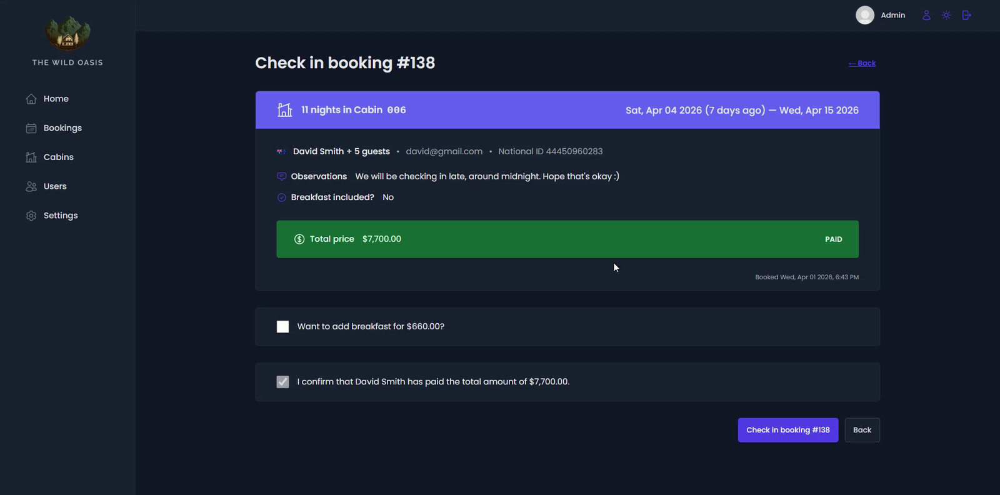
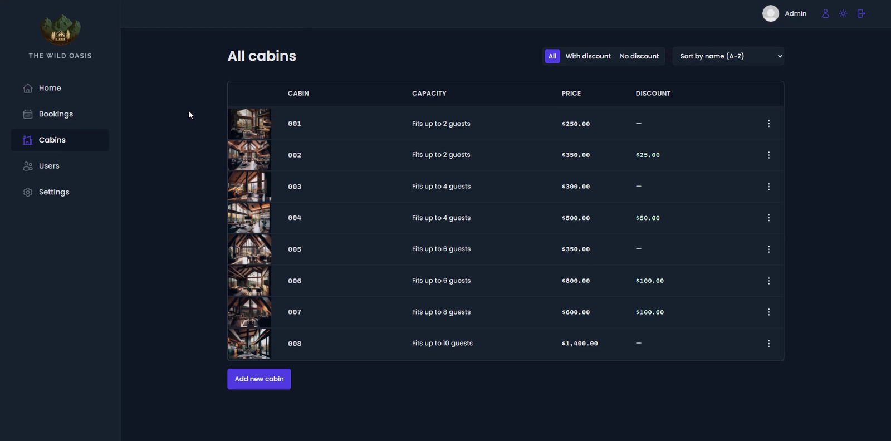

# 🏕️ The Wild Oasis — Admin Dashboard

Internal hotel management app used by staff to manage cabins, bookings and guests.
Main project of Jonas Schmedtmann's *Ultimate React Course* (Udemy), built with React, React Query and Supabase.

## 📸 Screenshots






## 🚀 Features

- **Dashboard** – bookings, sales, check-ins and occupancy stats, with charts for the last 7, 30 or 90 days
- **Bookings** – filter by status, sort and paginate; view details, check in and check out guests
- **Cabins** – create, edit, duplicate and delete cabins, with image upload and discounts
- **Users** – create new staff accounts and update profile, avatar and password
- **Settings** – hotel-wide settings (min/max nights, max guests, breakfast price)
- **Authentication** – protected routes with Supabase Auth
- **Dark mode** – global light/dark toggle

## 🧰 Tech stack

React · React Router · React Query · React Hook Form · Styled Components · Recharts · Supabase · Vite

## ⚙️ Getting started

```bash
npm install
npm run dev
```

Requires a Supabase project. Add your Supabase URL and key to the environment variables before running.

## 👤 Author

**Pedro Costa** – Web Developer
[Portfolio](https://pcostaaa.github.io/Portfolio/) · [LinkedIn](https://www.linkedin.com/in/pedroabcosta/) · [Behance](https://www.behance.net/pedrocosta262)
